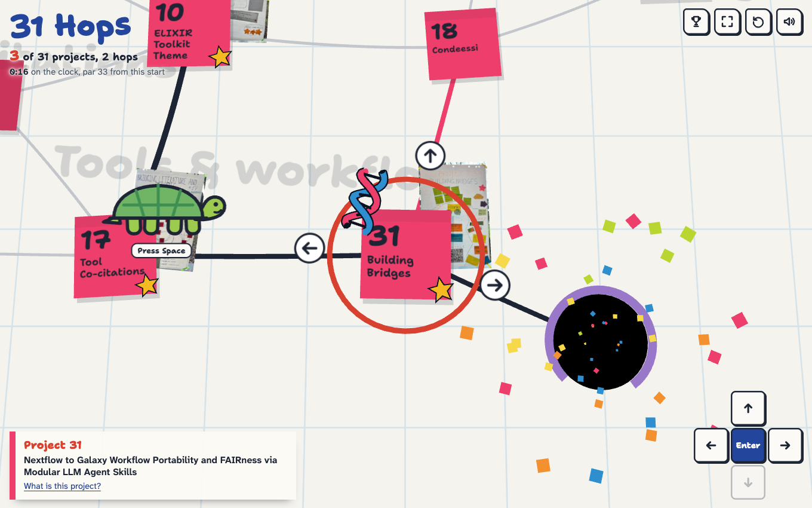
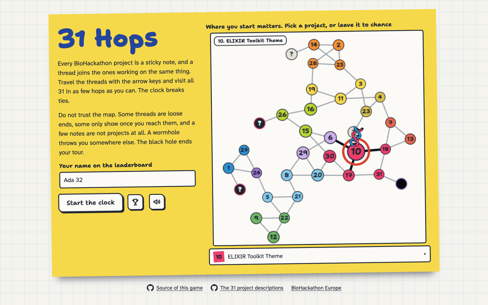

# 31 Hops

The 31 projects of BioHackathon Europe 2026 as a graph you can play. Each
project is a sticky note, and a thread joins two projects that work on the same
kind of thing. You move a double helix along the threads with the arrow keys
and try to visit all 31 in as few hops as possible. Reaching a project pins up
its poster; reading it is optional.



Controls: arrow keys, or swipe, or the on-screen arrow pad. Enter, or the key
in the middle of the pad, opens the poster of the project you are on; there the
left arrow goes back and up and down scroll. "Whole graph" pulls the camera
back. Space scares off whatever has wandered in front of the graph.

Before the first tour a player gives a name and picks where to start, on a
small map of the graph. The server starts the clock, stores every hop, and
scores the tour when the last project is reached. The leaderboard ranks by
fewest hops; equal hops are decided by time. A player's best tour counts.



## What makes it harder

The map is not honest, and it is dishonest in the same way for everyone:
`src/tricks.ts` works it all out from the graph, with no dice.

- Seven real threads are not drawn until the helix stands at one end of them.
- A few drawn threads join nothing. They drop when the helix reaches an end.
- A couple of notes are not projects and cannot be reached. One of them asks
  about the network socket in the toilets.
- Two wormholes, each beside one project, throw the helix to another project.
  Stepping in is a hop and being thrown is not, so a tour can come in under
  par. Where a wormhole leads is fixed by the tour's number and the step, so
  the game can show it at once and the server can check it.
- One black hole ends the tour: the screen goes dark and the only way on is to
  start again.
- A turtle, a lemur, a croissant and some spiders take turns getting in the
  way (`src/Critters.tsx`). They cost time, never hops. They stay away for
  anyone whose system asks for reduced motion.

Of all this only the wormholes reach the server, which scores the walk against
the real graph and reads `src/tricks.ts` to know where each wormhole leads.
Sounds are synthesised in the browser (`src/sound.ts`) and can be muted.

Built with three.js through react-three-fiber and Motion on the client, and a
small Express server with SQLite behind it. A device without WebGL 2, or one
that fails to download the 3D part, gets the projects as a plain list instead.

## Run

Needs Node 22.18 or newer, which runs the server's TypeScript as is.

```sh
npm install
npm run api        # game server on http://localhost:8787, database in ./hops.db
npm run dev        # client on http://localhost:5173, proxies /api
npm test           # server tests
```

The whole stack as it runs in production, on a laptop with Docker:

```sh
SITE=http://localhost docker compose up -d --build
```

## What the server trusts

Nothing the client says about its score. A tour is saved as the list of
projects walked, and the server checks that every step follows a link in the
same `graph.json` the client plays on, that the saved part of a tour is never
rewritten, and that it ends the moment all 31 have been seen. Hops are counted
from that list and time is measured on the server's clock from start to the
final save. A tour finished faster than 100 ms per hop is refused.

What it cannot stop is someone planning the best route on paper and then
playing it quickly, which is fair play, or a script that plays at human speed.

There are no accounts. A name belongs to the device that claimed it, through a
token kept in that browser; clearing the browser's storage loses the name. To
remove a player and their scores:

```sh
curl -X POST https://<host>/api/admin/remove-player \
  -H "authorization: Bearer $ADMIN_TOKEN" -H "content-type: application/json" \
  -d '{"name":"the name"}'
```

## Deploy

One small server (1 vCPU, 2 GB RAM with 4 GB of swap for the build) runs two
containers under rootful podman: Caddy, which serves the client and gets the
certificate, and the game server with its SQLite file on a volume.

1. Point A and AAAA records for the hostname at the server. Ports 22, 80 and
   443 have to be open to it.

2. On the server, once:

   ```sh
   sudo dnf install -y git podman podman-compose
   sudo fallocate -l 4G /swapfile && sudo chmod 600 /swapfile && sudo mkswap /swapfile && sudo swapon /swapfile
   echo '/swapfile none swap sw 0 0' | sudo tee -a /etc/fstab
   sudo systemctl enable --now podman-restart.service
   git clone https://github.com/yasinmiran/bhhops.git && cd bhhops
   sudo podman compose -f compose.prod.yml up -d --build
   ```

   The hostname is `bhhops.yasint.dev` unless `SITE` says otherwise. Caddy
   asks for the certificate once the name resolves and keeps retrying until it
   does.

3. To redeploy:

   ```sh
   cd bhhops && git pull --ff-only && sudo podman compose -f compose.prod.yml up -d --build --force-recreate --remove-orphans
   ```

   The database volume is kept, so names and scores survive.

The server makes its own admin token on first start. To read it, for the
`remove-player` call above:

```sh
sudo podman exec hops_api_1 cat /data/admin-token
```

To empty the leaderboard, for example right before the session it is meant
for, run this from a laptop. It keeps a copy of the old database on the
server's volume, then removes every player and every tour; anyone mid-game is
sent back to pick a name.

```sh
ssh almalinux@<server> bhhops/deploy/reset.sh
```

There are no other backups.

## Where the content comes from

| Path | What |
|---|---|
| `scripts/projects.json` | Official titles and leads from `elixir-europe/biohackathon-projects-2026` |
| `scripts/readings.json` | One reading per poster photo: transcription, summary, highlights |
| `scripts/explainers.json` | A plain-language account of each project: the problem, this week, why it matters, a small glossary |
| `scripts/themes.json` | 13 themes, each project's themes and short name, and explicit links between projects |
| `scripts/build-data.mjs` | Crops the photos to the sheets; writes `public/posters/` and `src/posters.json` |
| `scripts/build-graph.mjs` | Chooses the links, lays the graph out, assigns arrow keys, computes par; writes `src/graph.json` |

The generated files are committed, so the site builds without the photos.
`AGENTS.md` says which file to edit when a team points out a mistake in its
project's text, name or links.

The readings and themes were made by a model, then checked by a second pass:
every summary against its photo, every theme tag against the project's abstract
and poster. They can still be wrong in places, and a team that disagrees with
its tags can change them in `themes.json` and rerun `build-graph.mjs`.

How the graph is made: two projects are closer the more themes they share
(rarer themes count for more) and closest when a poster or abstract names the
other project or a tool few others use. Every project keeps at most four links,
one per arrow key, and at least two, so there are no dead ends. Par is exact:
for every starting project the builder searches for the shortest tour that
visits everything, which takes about half a minute. It comes out at 32 to 34
hops depending on the start.

After a change to the text only, `npm run content` rebuilds `src/posters.json`
and leaves the images alone. To rebuild the images too, convert the photos to
upright JPEGs first (the originals are HEIC, which `sharp` cannot read):

```sh
node scripts/build-data.mjs <folder of JPEGs named like the originals>
npm run graph
```
